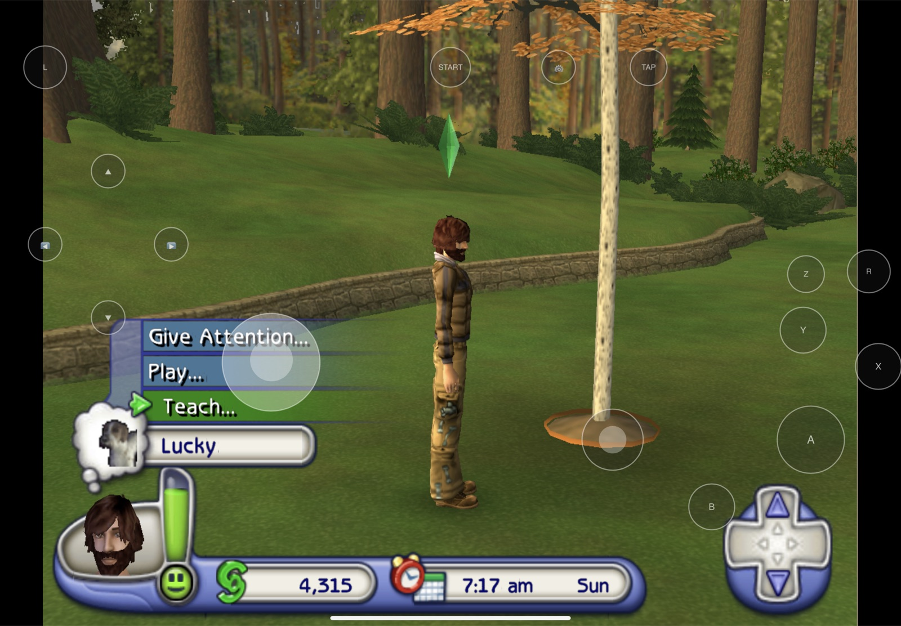

# The Sims 2: Pets for iPhone, iPad and Mac

A native port of **The Sims 2: Pets** (GameCube, USA, `G4OE69`) to iOS and macOS. The game's PowerPC code is statically recompiled to C ([DolRecomp](https://github.com/ExpansionPak/DolRecomp)) and runs on [ModernGekko](https://github.com/ExpansionPak/ModernGekko), a Dolphin-derived runtime. There is no emulator JIT, so it runs on an iPhone without a jailbreak.



**No game is included.** You build it from your own copy of the disc, and what you build contains the game's code and data: keep it to yourself.

## What this fork adds

- **iOS host**: Metal, AudioUnit sound, iOS 15+, no JIT anywhere (software vertex loader, interpreter fallback).
- **Touch controls** ([touchkit](https://github.com/vladbondarenko97/touchkit)): on-screen pad, stick and triggers that you can drag, resize and hide; 3 layouts; a hide-all ghost mode.
- **Tap to point**: tap a house, a menu item or an object, and the game's cursor goes there and clicks. A relative "touchpad" mode is also available; an on-screen button switches between them.
- **Pinch to zoom**, two-finger pan, **Bluetooth keyboard** (WASD walk, arrows rotate/zoom, Space = A, Esc = Start) and game controllers.
- **⚙ settings**: quality preset, internal resolution up to 4x, MSAA/SSAA, anisotropic filtering, widescreen hack, shader mode, volume, audio buffer, intro movies on/off.
- **Speed**: the game's idle loop is skipped (60 fps at about half the CPU). Cache-flush loops and calls between code chunks run without returning to the dispatcher (about 60% fewer round trips in a lot). Code the game rewrites at boot is recompiled already patched (`Data/Sys/GameSettings/G4OE69.ini`), so the intro no longer drops to the interpreter.
- **Intro skip** (the game's own `-nomovies` switch), on by default, plus an optional slim disc without the intro movies (~600 MB).
- **Cloud saves** (optional): sign in to a save server in ⚙ (iOS) or at first launch (Mac), and the memory card follows you across devices.
- **Mac app**: universal (Apple silicon and Intel).

## Build (a Mac with Xcode 15+)

```sh
brew install cmake ninja pkg-config
git clone --recursive https://github.com/vladbondarenko97/sims2pets-ios
cd sims2pets-ios
scripts/build_ios.sh "/path/to/The Sims 2 - Pets (USA).rvz" --slim
```

Your disc can be `.iso`, `.gcm` or `.rvz` (Dolphin's compressed format). The first run takes a while: recompiling the game takes about 30 minutes. You get:

- `build/ios/Sims2Pets.ipa`: the app.
- `build/ios/game/`: the game data for the device (`sys/`, `disc.rvz`).

Options:

- `--slim` writes the device's copy of the disc without the intro movies. It needs "Intro movies: Skip", the default.
- `--with-game` puts the game inside the IPA, so there is nothing to copy afterwards (a ~600 MB IPA).

### Install

- **SideStore / AltStore** (no jailbreak; with a free Apple ID you re-sign every 7 days): install the IPA. Free accounts can't use the extended memory entitlements; the game still runs.
- **TrollStore**: install the IPA as is.

Then, unless you used `--with-game`, copy the game in:

- **Finder**: connect the device, open it in Finder → Files → Sims 2 Pets, and drag `build/ios/game` in. The folder must be named `game`.
- **Files app**: On My iPhone → Sims 2 Pets.
- **Jailbroken devices with OpenSSH**: `scripts/ios/push_game.sh`.

Game data stays when the app is updated.

### Mac

```sh
scripts/build_module.sh mac
scripts/macos/make_app.sh       # OUT=/some/folder to choose where
```

## Controls

| | Touch | Keyboard |
|---|---|---|
| Move cursor / walk | tap (point mode) or drag (touchpad mode), left stick | WASD |
| Select | tap, A | Space, Enter, E |
| Back | B | Backspace, Q |
| Rotate / zoom camera | right stick, pinch | arrows, `,` `.` `-` `=` |
| Pause menu | START | Esc, P |

## Cloud saves

Host your own with `server/saves_server.py` (Python 3, nothing to install):

```sh
python3 server/saves_server.py --add-device ipad    # prints the device's password
python3 server/saves_server.py 8805                 # put HTTPS in front of it (Caddy, a tunnel, ...)
```

Then sign in on each device with the server's address, the device name and its password. The client (`lib/ModernGekko/src/ios/save_sync.mm`) speaks a small HTTP API, and any server that implements it works:

- Basic auth (device name + password) on every request.
- `GET /v1/sims2pets/` → `{"<file>": {"mtime": <unix>, "sha256": "<hex>"}, ...}`
- `GET /v1/sims2pets/<file>` → the file, with its time in `X-Mtime`.
- `PUT /v1/sims2pets/<file>` with `X-Mtime: <unix>` → 200, or 409 when the server's copy is newer.

## Credits

[ModernGekko](https://github.com/ExpansionPak/ModernGekko), [DolRecomp](https://github.com/ExpansionPak/DolRecomp) and [ModernGekko-Template](https://github.com/ExpansionPak/ModernGekko-Template) (its original README is `TEMPLATE_README.md`) by ExpansionPak; [Dolphin](https://dolphin-emu.org). ModernGekko and Dolphin are GPL, and so are this fork's changes to them.

The Sims is a trademark of Electronic Arts. This project is not affiliated with or endorsed by EA, Maxis or Nintendo.
